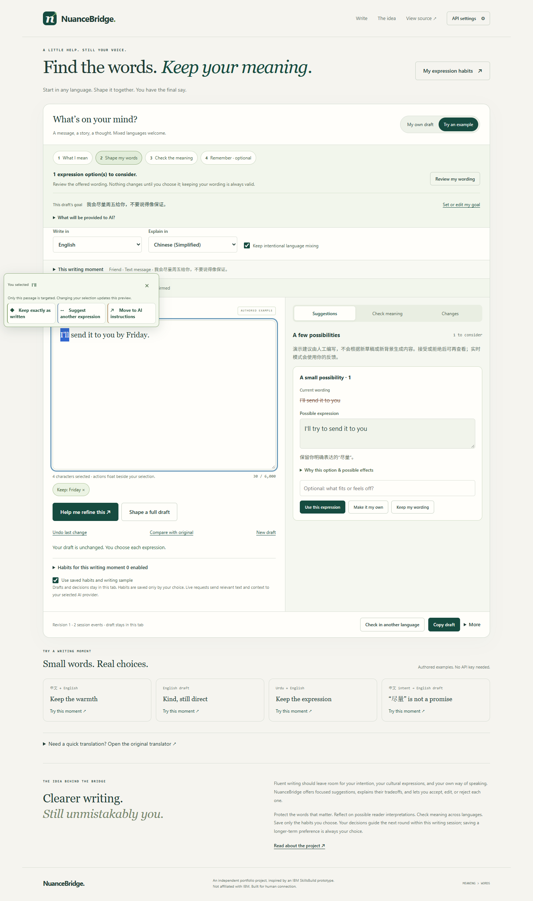

# NuanceBridge

**Find the words. Keep your meaning.** A multilingual writing companion for shaping a message without giving up your meaning, cultural expressions or final say.

[Open on Vercel](https://nuancebridge.vercel.app/) · [GitHub Pages](https://lee-arts-02.github.io/informal-translation-companion/) · [Deployment checks](https://github.com/Lee-arts-02/informal-translation-companion/actions)



## A connected writing journey

1. **Start with your words.** Write in English, another language, or a mixture. Context is optional. Choose a writing language and an explanation language independently.
2. **Clarify your intentions.** Add your own constraints or request evidence-grounded AI interpretations. User instructions, tentative model interpretations and user-confirmed interpretations have distinct labels. Confirming every card is never required.
3. **Shape a passage.** Suggestions show current wording, an editable alternative and its possible tradeoffs. Use it, make it your own, or keep your wording. Full-draft generation always requires preview and explicit acceptance.
4. **Check in another language.** Inspect the current draft in a familiar language, optionally flag a passage, explain a mismatch, and preview local repairs in the writing language. Accepting a repair returns to the same draft.
5. **Remember selectively.** A correction can become a candidate habit, but only your explicit save stores it. Review its wording, source and scope before saving. Copying your draft never requires saving a habit or completing a check.

The **“尽量” is not a promise** authored example demonstrates the complete journey without an API key: inspect intent, see the overstatement in Chinese, explain that “尽量” means trying rather than guaranteeing, accept a local English repair, and optionally save a scoped habit. Three additional examples explore warmth, boundaries and a cultural idiom. All demos are clearly labeled authored; changed wording outside their curated variants requires live mode. The authored repair fixture supports the uncertainty example, not arbitrary feedback.

The journey strip keeps the current goal visible and offers optional routes between intention, wording, meaning checks and future habits. Its next-action cue reflects the current session state rather than a mandatory completion score. **What will be provided to AI?** separates explicit context and confirmed intention cards from pending interpretations, and indicates when text or inputs changed after a request. Pending model guesses are not sent as writing instructions until the user confirms them.

Language checks guide the writer through **read → decide → refine**. The current draft can be viewed alongside the other-language snapshot; mismatch prompts help start feedback without overwriting existing notes. **This matches what I mean** records the writer's judgment for that exact check version, not model-verified accuracy. Text/context changes invalidate that status. Candidate habits open directly in an unsaved review form with source, editable wording, scope presets, a plain-language matching preview and an explicit return-to-draft path. Confirming a draft intention and saving a future habit remain separate actions.

On phones the companion opens as a dismissible bottom panel, preserving the draft. Context, intention details, suggestion explanations and additional reader perspectives use progressive disclosure.

## First visit and next steps

The entry hint distinguishes the free authored example from personal live use before requesting an API key. Intention confirmation, editing and removal retain keyboard focus; **Back to writing** returns directly to the draft. After accepting or keeping wording, the visible companion panel shows the outcome and offers **Check this version**, an optional habit review when relevant, and **Keep writing**. This also keeps habit saving reachable inside the phone panel.

The checking form reveals results only after a check exists, expands the current-draft comparison, and labels stale checks with an update action. Marking a version as matching resolves the active mismatch note (retained in the session record) and exposes a copy action. Authored checks retain their source label and become stale when switching to live mode. Curated examples disclose which repair paths they support instead of offering nonfunctional feedback buttons.

Habit review shows the actual matching scope before optional detailed fields. Save controls remain reachable while scrolling; returning from the dialog reveals the draft rather than focusing it behind the phone sheet. Popup touch targets and copy feedback visibility were also checked. These changes were verified through fresh-context desktop and touch-mobile browser walkthroughs, not a participant usability study or physical-device keyboard evaluation.

## Words, instructions and protected expressions

Select a passage to **keep these words**, **find an expression**, or mark **this is a note to AI**. Moving a note out of the final draft requires confirmation. Undo restores moved notes and their prior task instructions unless those instructions were subsequently edited.

Selecting a passage opens three contextual actions: **Keep exactly as written**, **Suggest another expression**, and **Move to AI instructions**. Descriptive labels, hover help and accessible explanations distinguish keeping the original wording, previewing alternatives and moving a note out of the final text. Unavailable actions are disabled with guidance; completed protection and note moves show local feedback and an undo path. This guidance draws on metacognitive-scaffolding considerations from [Ramesh et al., CHI 2026](https://arxiv.org/abs/2602.05111), applied here as a writing-interface design hypothesis rather than a proven outcome.

The toolbar floats **immediately above the visible selected words**, including selections in the middle of the textarea. A local text-layout mirror accounts for soft wrapping, mixed scripts and internal scrolling. It tracks page scrolling, resizing and the visual viewport, flips below only if necessary and hides when the selection leaves view or another mobile panel is open. Click elsewhere, use its close button, or press Escape to dismiss. Keyboard selection followed by Tab enters the actions; Tab can leave without trapping focus. The rest of the journey applies the paper's ideas of visible goals, workflow guidance, input transparency and user-controlled stopping cues, without treating health-domain findings as writing-usability evidence.

Protection applies to the selected occurrence, including repeated expressions and Unicode. It is enforced in code for manual edits, local replacements and full starting drafts. Remove a protection chip before changing that expression.

Writing, explanation and checking languages are separate. Writing and checking menus contain 28 choices, including Simplified/Traditional Chinese and Cantonese. An explicit setting allows intentional language mixing; protected expressions always take precedence.

## Inspectable influence and habits

**Changes** records offered wording, accepted or user-edited results, rejected suggestions, intent decisions, checks and habit actions. Continuous typing is grouped. Session records can be explicitly downloaded; they are not collected as analytics or automatically persisted.

Suggested intention links and reader interpretations are model judgments, not internal causal evidence. The app records which matched habits were provided to a request; it does not claim those habits caused particular output. Possible habit conflicts must cite an actual supplied habit and explicit current instruction; users can skip the habit and request a fresh review. Current explicit instructions take priority over older habits in the prompt.

**My expression habits** supports:

- Explicit saving, editing, pausing, deletion, source inspection, JSON export/import and clearing.
- Scope by reader label, channel and writing language. All nonempty scope fields must match, case-insensitively; free-text reader labels are matched exactly, not inferred semantically.
- Per-writing-session exclusions and a global writing-profile switch. Paused, out-of-scope or excluded habits do not enter writing requests. The quick translator uses the same habit store with its own context and enable switch.
- Migration of earlier explicitly saved style preferences, retaining their disabled state where recorded and marking their scope as unset. Samples remain explicitly chosen examples, never silently extracted from accepted AI text.
- Atomic, size-bounded imports. Import replaces the list only after confirmation; imported source labels are file-supplied assertions, not authenticated history. Custom imported scopes survive editing.

Habits live only on the current browser; no accounts or cross-device sync are provided. If browser storage is denied, explicit saves work for the visit with a visible warning. Invalid existing habit data is preserved until the user explicitly imports a replacement or clears it.

## Personal live mode

Open **API settings** and enter your own [OpenRouter key](https://openrouter.ai/settings/keys) and a model ID. The key stays in tab memory and is cleared on reload/navigation or **Forget key**. The app does not place it in localStorage, URLs, exports or source code.

Live requests share the relevant text and context with OpenRouter and its selected model provider and may incur charges. Browser extensions may access credentials entered in a browser. Provider quality, costs and retention vary. No shared or owner-funded API account is supplied.

Backtranslation uses a **separate source-blind request** containing only the current draft, checking language and protected-expression glossary. Original text, intent, history, saved habits and writing samples are excluded. Comparison and repair are separate requests that can use the original, current intentions and user feedback. This separation reduces a source of bias; it does not guarantee independence or accuracy.

Each check is bound to the draft revision, checking language and context. Changes mark it stale and disable repair until a new check. Changing correction notes or flagged passages cancels pending repairs and removes stale repair previews. Context changes invalidate pending suggestions and starting drafts. No numeric “meaning accuracy” score is presented.

## Other tools

The original quick translator remains collapsed below the writing workspace, with its context controls, register alternatives and three examples. **More → Export for human feedback** downloads a manual review copy; returned notes can be pasted into the app. There is no automatic sharing or live collaboration room.

## Run, test and deploy

The deployed app is static HTML/CSS/ES modules with no runtime dependencies, external fonts or analytics.

```sh
python -m http.server 8000 --bind 127.0.0.1
npm run check
npm test
```

The optional browser suite needs Playwright and a Chromium installation available in your development environment:

```sh
npm run test:browser
```

It starts its own local server. `CHROMIUM_EXECUTABLE` selects a browser executable; installed Windows Chrome is used when available, otherwise Playwright's Chromium. `TEST_URL` targets an already deployed copy. `node tests/writing-browser.cjs` remains an alias for this complete suite.

Browser checks cover the authored journey, controlled live request bodies, scoped and paused memories in both tools, per-session exclusions, imported scopes, stale in-flight repairs, protection, undo, key/reload privacy, denied storage and phone layouts. Live requests are intercepted with a nonfunctional fixture key; these tests do **not** evaluate paid-model translation quality or establish research effectiveness.

For **Vercel**, choose the repository root, Framework **Other**, no build command, Output Directory `.`. No deployment API key is needed. For **GitHub Pages**, choose Settings → Pages → Source → GitHub Actions. The workflow verifies syntax/unit tests and publishes an explicit public-file allowlist, excluding plans, tests and source PDFs.

## Implementation

| Module | Responsibility |
| --- | --- |
| `writing-session.js` | Protected-range edits, immutable revisions, undo, safe suggestion rebasing |
| `intent-state.js`, `intent-ui.js` | Evidence-grounded intent origin, confirmation and editing |
| `memory-store.js`, `memory-ui.js` | Explicit scoped preferences, migration, validation and management |
| `workflow-state.js`, `writing-panels.js` | Version-bound checks, grouped events and inspectable suggestions |
| `review-api.js` | Action-specific provider payloads and response validation |
| `writing-ui.js`, `writing-voice.js`, `ui-helpers.js` | Connected workflow, optional sample and shared controls |
| `app.js`, `translation.js` | Connection settings, retained translator and provider transport |

The project is an independent portfolio/research prototype inspired by an IBM SkillsBuild concept, not affiliated with IBM. Its intended benefits for authorship, cultural expression and personalization remain research questions requiring user evaluation.
