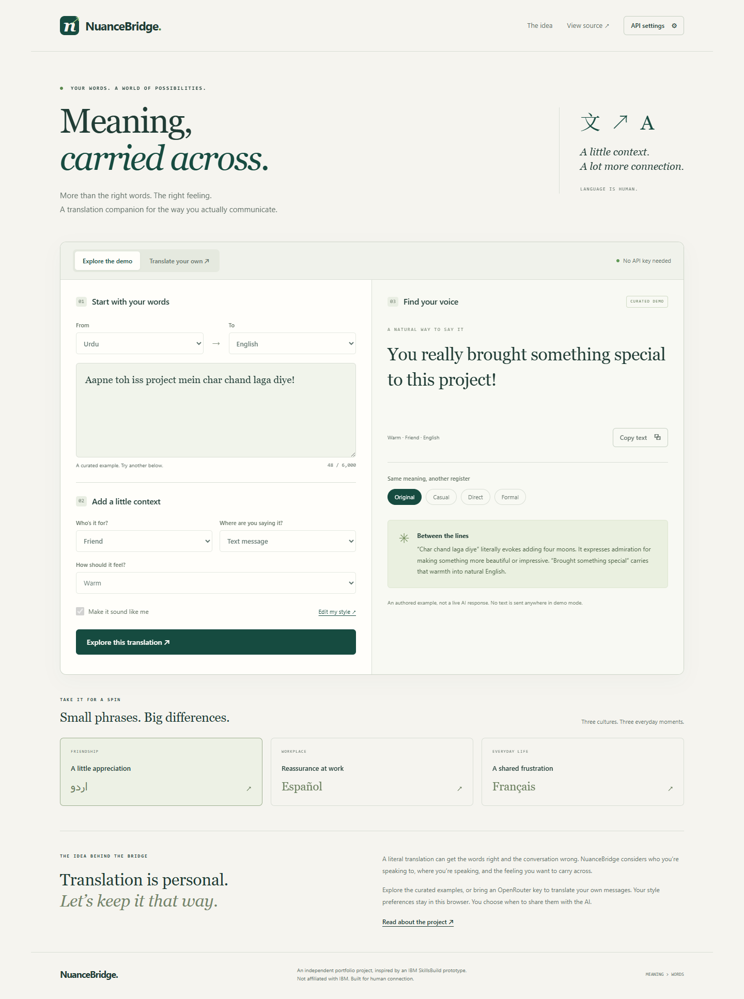

# NuanceBridge

**Meaning, carried across.** A personal translation companion that considers
tone, culture, recipient, and communication channel alongside the words.

[Open the companion](https://lee-arts-02.github.io/informal-translation-companion/)
· [Deployment runs](https://github.com/Lee-arts-02/informal-translation-companion/actions)



## Try it

The site opens in **Explore the demo**, with three curated Urdu, Spanish, and
French scenarios. Switch between natural, casual, direct, and formal phrasing
and read the explanation of each cultural choice. These are authored examples,
clearly labeled; they do not call an AI service. Demo inputs are fixed so a
curated result cannot be mistaken for a translation of newly entered text.

To translate your own text:

1. Open **API settings** and enter an [OpenRouter API key](https://openrouter.ai/settings/keys).
   Use a separate key with a low credit limit.
2. Keep `openrouter/auto` or specify a model ID from the
   [OpenRouter model catalog](https://openrouter.ai/models). Auto routing is not
   guaranteed to be free; charges depend on the selected model.
3. Select **Translate your own**, enter up to 6,000 characters, and choose the
   languages, recipient, channel, and tone.
4. Optionally enable **Make it sound like me** and edit your style preferences.
5. Translate, review the output, and copy the register you prefer. Ctrl+Enter
   (Cmd+Enter on macOS) also submits from the text box.

No key is included in this repository. No shared AI account is provided to
portfolio visitors. A saved session key is not verified until a request succeeds.

## Run locally

Serve the directory over HTTP (ES modules do not work reliably via `file://`):

```sh
python -m http.server 8000 --bind 127.0.0.1
```

Open `http://127.0.0.1:8000`. No npm install or build is needed to run the app.
Production deployment uses HTTPS through GitHub Pages.

## Deploy on GitHub Pages

1. In this repository, open **Settings → Pages**.
2. Under **Build and deployment → Source**, select **GitHub Actions**.
3. Open **Actions → Verify and deploy NuanceBridge**. Run the workflow, or push
   a commit to `main`.
4. The workflow checks syntax, runs unit tests, packages only the seven public
   app files, and deploys them. The deployment reports the website URL.

The intended URL is
`https://lee-arts-02.github.io/informal-translation-companion/`.
It becomes available after Pages is enabled and the deployment succeeds.
No API key or Actions secret is required for deployment. Never put a personal
provider key in GitHub source, Actions variables, or a generated static bundle.

## Privacy and boundaries

- The key is held in tab memory only. Reload, **Forget key**, or navigating away
  clears it. The app does not write it to localStorage, sessionStorage, URLs,
  analytics, or logs. Browser extensions and developer tools can still access
  browser-entered credentials; a browser-only app is not a secret vault.
- Live requests send source text, selected context, and enabled preferences
  directly to OpenRouter and its selected model provider. Their privacy and
  retention policies apply. Cancelling stops this app's request; it may not stop
  provider processing or charges already incurred.
- Only explicit style preferences, the model ID, and the style toggle persist
  locally. Source text and translation history are not saved by the app.
- Demo mode makes no AI requests. There are no analytics, runtime third-party
  scripts, CDN stylesheets, or external font requests.
- AI may misinterpret idioms or change meaning. Review outputs before sharing.
  This project is not a certified translation service.
- There is no automatic learning or IBM Bob integration. This independent
  portfolio project was inspired by an IBM SkillsBuild HTML prototype and is
  not affiliated with or endorsed by IBM. The original file is retained as a
  reference and is excluded from the deployed site.

## Verify

Use Node.js 22 or newer:

```sh
npm run check
npm test
```

Unit tests use controlled HTTP responses, with no paid API calls. They cover
request context, input limits, structured output validation, provider errors,
timeouts, cancellation, storage failures, and exclusion of credentials and
translation text from saved preferences.

The optional browser check requires Python and Playwright:

```sh
python -m pip install playwright
python -m playwright install chromium
# With the local server running in another terminal:
python tests/browser_smoke.py
```

Browser checks exercise demo/live transitions, preference persistence, safe
rendering, a controlled live response, API errors, session key clearing, and
mobile layout. Paid live translation quality is not verified by these tests.

Local verification: JavaScript syntax checks and all 11 unit tests passed.
Equivalent headless Chromium smoke checks passed at desktop, 390px, and 320px
widths with controlled API responses. No paid provider request was made.

## Structure

| File | Responsibility |
| --- | --- |
| `index.html`, `styles.css` | Accessible, responsive interface |
| `app.js` | Mode transitions, controls, session credentials, and rendering |
| `translation.js` | Prompt construction, provider requests, validation, and errors |
| `preferences.js` | Allowlisted non-secret local preferences |
| `demo.js` | Authored portfolio scenarios |
| `tests/` | Unit and optional browser checks |
| `.github/workflows/pages.yml` | Verification and deployment |

Design decisions and the implementation checklist are in
[`plan/translation-companion-design.md`](plan/translation-companion-design.md).
